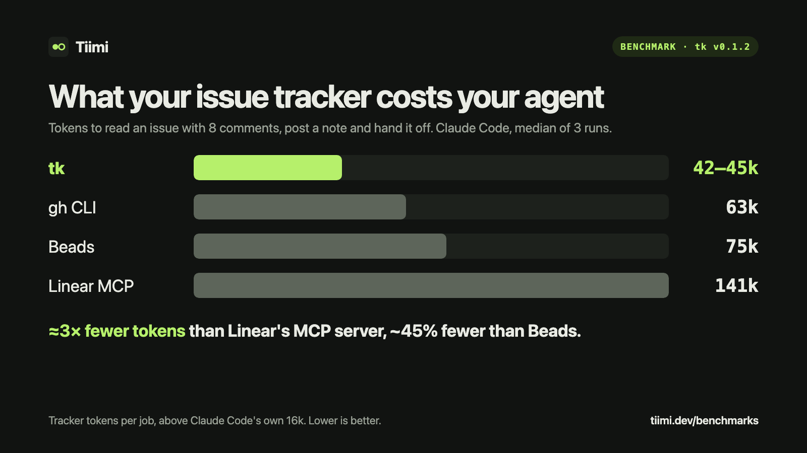

I run Claude Code and Codex most of the day, and most of that work is tied to issues: read the ticket, do the work, post progress, hand it off. At some point I wondered what the *tracker part* of that loop costs, separately from the coding itself.

Every time an agent reads an issue, posts a note or hands work off, the integration it uses costs tokens: instructions it has to load, tool definitions, and whatever the tracker sends back. Nobody seemed to measure it, so I did.

## The setup

One job, done the same way through each integration:

> Find the open issue about EU refunds, read it with its full comment history (8 comments), post a given progress note, and hand the issue back for the next session.

- **Agent:** Claude Code (`claude -p`), Sonnet 5.5
- **Runs:** 3 per integration, medians reported
- **Each tool used its official setup:** `tk init` for Tiimi, `bd setup claude` for Beads, the `gh` CLI, and Linear's remote MCP server
- **Fresh state every run:** a new folder and a freshly seeded issue, with only that project's settings loaded
- **"Tracker tokens"** = the input tokens the agent processed, minus Claude Code's own fixed cost (about 16k, measured with no tracker at all)

## The results



| Integration | Tracker tokens | Cost per job | Time | Turns |
| --- | --- | --- | --- | --- |
| **Tiimi, local** | **42k** | **$0.051** | **9.7 s** | 3 |
| Beads | 75k | $0.066 | 11.2 s | 4 |
| **Tiimi on GitHub Issues** | **44k** | **$0.049** | 18.1 s | 3 |
| `gh` CLI | 63k | $0.059 | 15.9 s | 4 |
| **Tiimi on Linear** | **45k** | **$0.053** | **18.1 s** | 3 |
| Linear MCP | 141k | $0.099 | 24.0 s | 6–8 |

Head to head:

- **vs Linear's MCP server:** ≈3× fewer tokens, about half the cost, 25% faster
- **vs Beads:** 44% fewer tokens, 23% lower cost, 13% faster
- **vs the `gh` CLI:** 30% fewer tokens and 17% lower cost (about 2 seconds slower, because Tiimi also moves the issue's status)

Every run of every integration finished the job.

## Where the tokens go

Reading the session traces made the differences obvious.

**Linear MCP** loads its tool definitions, then the agent searches, fetches the issue, fetches the comments, posts, and updates the status: six to eight model turns. Each turn re-sends the growing context, and the responses are JSON with IDs, timestamps and metadata the agent never uses.

**Beads** is efficient once it's going (search, show plus comments, comment), but it pays about 2k tokens up front every session: `bd prime` injects its command reference, and its `CLAUDE.md` loads too. In return the agent knows exactly what to run, and it showed: four turns, every time.

**The `gh` CLI** is lean, but the agent has to ask for `--json` with the right fields, and the issue with comments came back as 4.5 KB of JSON.

**Tiimi** gives the agent a session-start brief of about 200 tokens: the open issues plus a one-line command card, so it never runs `--help`. `tk show` returns the issue and all comments as plain lines (1.7 KB here), and a single chained command claims the issue, posts the note and hands it back. Three turns, every run.

The pattern: **fewer turns matter more than smaller responses**, because every extra turn re-reads everything before it.

## What else Tiimi does

The benchmark measures the tracker layer, but the reason I built [Tiimi](https://tiimi.dev) is the loop around it:

**Cost per issue, from logs you already have.** Run this once:

```sh
tk receipt
```

It reads the logs Claude Code and Codex write on your machine, prices each reply at list price, and groups the cost by issue from your branch names (`eng-142-fix-login` → ENG-142). No setup, nothing uploaded. On a subscription it still shows which issues eat your usage limits.

**Handoffs between sessions and between agents.** When an agent runs low on context it runs:

```sh
tk handoff "Rounding fixed in refunds.ts. Left: 2 failing tax.spec cases. Decimal.js everywhere was 3x slower, reverted."
```

The next session, Claude Code or Codex, starts from that note: what's done, what's left, and the dead ends, so it doesn't retry the same failed approach.

**Your existing tracker.** It works with Linear, GitHub Issues and Jira (beta), or a local store, so there's no second tracker to keep in sync.

Here's the full loop in 50 seconds, on a sample project:


## Run it yourself

The prompts, seed data, raw results and the benchmark script are in the repo under [`bench/trackers`](https://github.com/tiimihq/tk/tree/main/bench/trackers). It's one workflow on one issue, so rerun it on your own setup; I'd like to see the numbers from other agents and bigger histories.

To try Tiimi:

```sh
curl -fsSL https://tiimi.dev/install | sh    # or: brew install tiimihq/tap/tiimi
tk receipt
```

It's free and MIT-licensed: [github.com/tiimihq/tk](https://github.com/tiimihq/tk). If you run it, I'd love to hear what your most expensive issue was.
